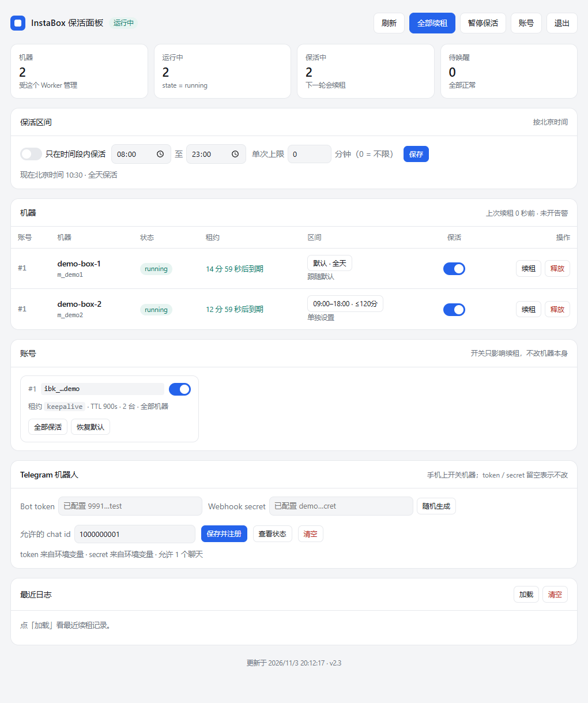
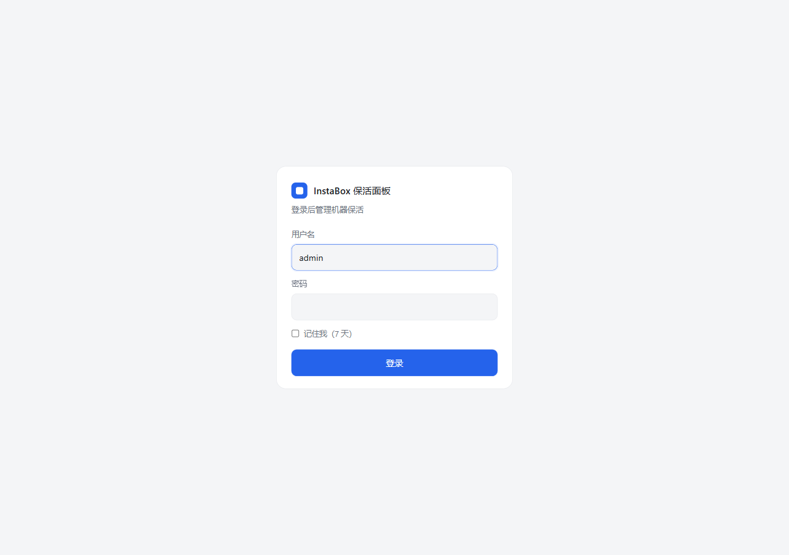

# instabox-keepalive

[InstaBox](https://instabox.sh) 的机器空闲 30 分钟就会自动休眠（`auto-suspend`）。本仓库一个 `keepalive.sh` 搞定保活：用官方 **activity lease** 定期续租，让机器一直醒着；另有 **Cloudflare Worker** 版，不想自己找台常开机器时用；**Docker** 版给 NAS / 群晖 / 1Panel 这类容器环境。三种跑法都支持多账号（多把 key 无限叠加）和 409 自愈（被挂起自动唤醒再续租）。Worker 版还带一个**网页管理面板**（登录后进 `/ui`）：逐台开关保活、看租约到期倒计时、手动续租/唤醒/释放、翻最近日志（可一键清空），全程点鼠标；面板里还能设**保活区间**（每天哪几个时段 + 单次最多保活多久，可设多段，按北京时间），不想 7×24 烧免费额度就用它。另外还有个 **Telegram 机器人**，手机上就能唤醒/休眠/关机、也能改保活区间 —— 见 [docs/TELEGRAM.md](docs/TELEGRAM.md)。

> **为什么不能直接把休眠关掉**（`autoSuspendAfterSeconds=0`）？2026-10-18 实测：普通/邀请制账号的 `/v1/me` 里有 `"fixedAutoSuspendSeconds": 1800`、`"manualLifecycle": false`，服务端把空闲挂起阈值**锁死在账号级**，因此对 `PATCH /v1/machines/{id}` 传 `autoSuspendAfterSeconds: 0`（或任何值，含官方 `instabox auto-suspend <box> 0` 与 SDK `setAutoSuspend`）**一律被静默忽略**：返回 200，值仍是 1800。所以只能用租约这条官方口子。

> 想用官方 `instabox` CLI 手动建机 / 进机 / 快照 / 开端口——见 [docs/CLI.md](docs/CLI.md)（CLI 操作手册）。

> 为什么不在机器里面跑保活：机器一 suspend，里面的 cron/systemd 定时器全都冻住，谁也叫不醒自己。续租必须来自**外部**、靠那次出网请求带出去 —— 这也是 Worker 版要放到 Cloudflare 的原因；`keepalive.sh` 装在你自己的常开机器上，同样满足。

## 获取账号的 API key

三种跑法都得先有一把 InstaBox 账号的 API key（形如 `ibk_...`）——下面命令里的 `ibk_xxx` 都指它。key 不是脚本生成的，要在 InstaBox 网页控制台里创建，入口藏得有点深：

1. 打开 [instabox.sh](https://instabox.sh)，用 GitHub 或 Google 登录进控制台
2. 点右上角**账号菜单 → Profile → API keys**
3. 点 **Create Key**，权限二选一：
   - **Full access** —— 全权限，省事
   - **Restricted** —— 自己勾 scope；**只做保活用 `machines:write` 就够**（write 含 read；`machines:delete`、`images:*` 都不需要）
4. 建完**立刻复制**：key 只在创建时显示一次，弹窗关了网页上再也看不到，丢了只能删掉重建

几个容易踩的点：

- key 长这样 `ibk_...`；GitHub/Google 登录只用来进控制台和建 key，**不能拿登录态当 key 用**
- 一把 key 对应一个账号。多个账号就建多把，安装时逗号连起来：`key=ibk_aaa,ibk_bbb`
- key 泄露或要换：到同一个 **API keys** 页面 revoke 旧的、建新的，然后改本机 `.env`（见下文）
- 官方文档：<https://instabox.sh/docs/keys-sdk>

> 权限提醒：带 `machines:write` 的 key 能在机器里执行代码、还能选用 org Secrets。只保活的话别给它 `machines:delete`，也别用 Full access。免费额度、机器上限在控制台的 Account 页看（接口是 `GET /v1/usage`）。

## VPS 版 keepalive.sh：一键安装

把脚本装到任何一台常开的机器（VPS/NAS/路由器），cron/systemd 定时续租，也支持多账号：

```sh
# 保活名下全部机器（有几台保几台，机器名都不用填）
key=ibk_xxx bash <(curl -Ls https://raw.githubusercontent.com/longtimex/instabox-keepalive/main/keepalive.sh)

# 只保某一台
key=ibk_xxx machine=qqq bash <(curl -Ls https://raw.githubusercontent.com/longtimex/instabox-keepalive/main/keepalive.sh)

# 非 root： curl -Ls <同一个地址> | sudo -E env key=ibk_xxx machine=qqq sh

# 多账号：key 逗号分隔多把，每把 key 各保各的，无限叠加、单个也能跑
key=ibk_aaa,ibk_bbb,ibk_ccc bash <(curl -Ls https://raw.githubusercontent.com/longtimex/instabox-keepalive/main/keepalive.sh)
```

就一个文件：不带参数＝安装/更新，`uninstall`＝卸载，`--once` / `--watch` / `--status` / `--release`＝手动用，`--help` 看全部参数。装完会立刻做一次续租自检，失败就不装；服务形式按系统自动挑 **systemd → OpenRC → cron**。

想升级直接再跑一次安装命令（按现有 `.env` 重装，key 不会丢）；以后加账号就是往 `.env` 的 `INSTABOX_API_KEY` 后面续 `,ibk_xxx`。

**机器筛选**

- 不填 `machine`（推荐）：脚本用你的 key 调 `GET /v1/machines` 自己列出名下所有机器，全部保活，新加机器下一轮自动跟上
- 填 `machine=qqq` 只保这一台；也可以填机器 id（`m_...`）；`machine=all` 和不填一样
- 多把 key 时 `machine` 对每把 key 各自生效（比如 `machine=qqq` 就是每把 key 各保自己名下的 `qqq`）

**日常**

```sh
sh /root/instabox-keepalive/keepalive.sh --status    # 机器状态（不填机器=全部）
sh /root/instabox-keepalive/keepalive.sh --once      # 手动续一次
sh /root/instabox-keepalive/keepalive.sh --release   # 放掉租约，恢复空闲休眠
sh /root/instabox-keepalive/keepalive.sh uninstall   # 彻底卸载（停服务、删 unit、清 cron、放租约、删目录）
```

**变量**（`.env` 或安装环境变量；`--dir` 默认 `/root/instabox-keepalive`，`--service` 默认 `instabox-keepalive`，还有 `--lease` `--ttl` `--raw` `--cron` `--no-start`）

| 变量 | 默认 | 说明 |
| --- | --- | --- |
| `INSTABOX_API_KEY` | 无（必填） | `ibk_...`，多把逗号分隔 |
| `INSTABOX_MACHINE` | 空＝全部 | 机器名 / id / `all` |
| `INSTABOX_LEASE` | `keepalive` | 租约名 |
| `INSTABOX_LEASE_TTL` | `300` | 秒，30–3600；想更稳就填 `600`（见《怎么把保活成功率做到最高》） |
| `INSTABOX_RENEW_EVERY` | `0.6 × ttl` | 续租间隔，0–86400 秒（实际最小间隔 5 秒） |
| `INSTABOX_AUTO_RESUME` | `1` | 遇 409 先按状态唤醒（wake / resume / start）再续；`0` 只报错不唤醒 |
| `INSTABOX_WAKE_GAP` / `INSTABOX_WAKE_TRIES` | `5` / `6` | 等唤醒完成的总窗口 = 两者相乘（默认 30 秒，实际收敛到 5–55 秒）。由 operation 长轮询消耗，不再自己 sleep 轮询 |
| `INSTABOX_ALERT_WEBHOOK` | 空＝不告警 | 续租失败/恢复时 POST 一条过去 |
| `INSTABOX_ALERT_FORMAT` | `text` | `text` / `feishu` / `dingtalk`（企业微信同款）/ `discord` |
| `INSTABOX_ALERT_MIN_INTERVAL` | `1800` | 同一故障最多多久发一次告警（秒），0–86400 |
| `INSTABOX_API_URL` | `https://api.instabox.sh` | 换私有网关时才用 |

数值项填错（非数字、前导零、超过 9 位）会直接报错退出；能解释但越界的数值（如 `WAKE_GAP=9999`）会收敛到边界并打一条警告，不会让服务起不来。环境变量与 `.env` 同名时以环境变量为准。

**密钥安全**：key 只落本机 `<安装目录>/.env`（0600，不进进程列表）；安装时 key 会出现在命令行一次，装完记得 `history -c`；建议只用 `machines:write` 权限的 key。

## 多个账号（三种跑法通用）

每个账号要一把**各自独立**的 key——都在同一个 **Profile → API keys** 页面里分别 Create Key（换台账号就先用那个账号登录一次网页建 key，见上文《获取账号的 API key》）。

`keepalive.sh` 和 Worker 都支持多账号：**第 N 个账号的变量名 = 单账号变量名 + `_N` 后缀**（脚本里也可以直接 `key=ibk_aaa,ibk_bbb`）。

| 1 号账号（和单账号完全一样） | 2 号账号 | 说明 |
| --- | --- | --- |
| `INSTABOX_API_KEY` | `INSTABOX_API_KEY_2` | **Secret**，必填 |
| `INSTABOX_MACHINE` | `INSTABOX_MACHINE_2` | 可选，留空 = 该账号全部机器 |
| `INSTABOX_LEASE` | `INSTABOX_LEASE_2` | 可选，默认 `keepalive` |
| `INSTABOX_LEASE_TTL` | `INSTABOX_LEASE_TTL_2` | 可选；脚本默认 `300`、Worker 模板 `900` |
| `INSTABOX_AUTO_RESUME` | `INSTABOX_AUTO_RESUME_2` | 可选，默认 `1` |

- 加一个账号 = 往 `INSTABOX_API_KEY` 里续 `,ibk_xxx`（脚本和 Worker 同款写法），或面板上加一个 `INSTABOX_API_KEY_2` Secret
- 带后缀的优先，没写的自动继承不带后缀的全局值；`INSTABOX_MACHINE` 也会继承，所以两个账号机器名不一样时记得写 `INSTABOX_MACHINE_2`
- 编号可以不连续（只配 `_2` 也能跑）；`INSTABOX_API_KEY_1` 等同于 `INSTABOX_API_KEY`
- 同一把 key 配了两次只续一次
- **一个变量塞多把也行（推荐，无限叠加）**：`INSTABOX_API_KEY = "ibk_aaa,ibk_bbb,ibk_ccc"`（逗号分隔）→ 自动按顺序当 1、2、3 号账号，加账号就是往里续一段 `,ibk_xxx`。两种写法混着用也行：显式 `_N` 变量永远占自己的编号，多出来的往外推空位（比如 `INSTABOX_API_KEY="kA,kB"` 且 `_2=kX` → 1=kA、2=kX、3=kB）。单把 key 的老用法不变
- 每个账号的机器列表分开缓存、分开续租：某个账号 key 失效或机器被挂起，不影响其它账号
- `/accounts` 看现在认到了几个账号（key 打码）；`?account=2` 只操作 2 号（`/`、`/status`、`/release` 都支持）

**Worker 侧补充**（只对 Worker 生效；VPS 版没有 KV 和子请求限制）

- KV 绑定不用动：还是 `LOG`、还是每小时最多 1 条，多账号只是让每条日志里多几个 `account` 编号
- 免费版 Worker 每次调用最多 50 个子请求：一个账号大约「1 次列机器 + 每台 1 次续租」，账号/机器多的时候别超（付费版默认 10000 次）

**配置示例：三把 key，其它全用全局值（Worker 面板）**

面板 `Variables and Secrets` 里最终就这几条（key 和 token 都是 Secret）：

| 变量 | 类型 | 值 |
| --- | --- | --- |
| `INSTABOX_API_KEY` | Secret | `ibk_aaa…`（1 号账号） |
| `INSTABOX_API_KEY_2` | Secret | `ibk_bbb…`（2 号账号） |
| `INSTABOX_API_KEY_3` | Secret | `ibk_ccc…`（3 号账号） |
| `TOKEN` | Secret | 自己起一串随机值，例如 `openssl rand -hex 16` 的输出 |
| `INSTABOX_LEASE_TTL` | Text | `900` |
| `INSTABOX_LOG_MODE` | Text | `hourly` |

`INSTABOX_MACHINE` / `INSTABOX_LEASE` / `INSTABOX_AUTO_RESUME` 都不写，效果就是：每个账号保活自己名下**全部机器**、租约名 `keepalive`、碰到挂起/停掉自动唤醒。

**懒人写法（推荐）**：三种等价 —— 要几个加几个。

```sh
# 单变量塞多把（推荐）：加账号就是往里续 ",ibk_xxx"
INSTABOX_API_KEY = ibk_aaa,ibk_bbb,ibk_ccc
# 或每把一个 secret（老写法，效果一样）
INSTABOX_API_KEY   = ibk_aaa
INSTABOX_API_KEY_2 = ibk_bbb
INSTABOX_API_KEY_3 = ibk_ccc
# 或混着用（显式 _N 的编号优先，多出来的往外推空位）
INSTABOX_API_KEY   = ibk_aaa,ibk_bbb
INSTABOX_API_KEY_2 = ibk_xxx      # 占死 2 号位；任务变成 1=aaa 2=xxx 3=bbb
```

反过来，如果几个账号都只想保活同名的那台机器（比如都叫 `qqq`）：Worker 只写 `INSTABOX_MACHINE=qqq`，脚本写 `machine=qqq`，所有账号都会继承这个筛选。

## Docker 部署（NAS / 群晖 / 1Panel）

宿主机不想装东西就丢进容器：镜像里装的就是这个仓库的 `keepalive.sh`。

```sh
cd docker
cp .env.example .env && chmod 600 .env   # 填 INSTABOX_API_KEY=ibk_xxx
docker compose up -d --build
docker compose logs -f
```

变量名、多账号写法和 VPS 版完全一致，一份 `.env` 两边通用；`--status` / `--once` / `--release` 也能当一次性命令跑：

```sh
docker compose run --rm instabox-keepalive --status
```

## Cloudflare Worker 部署（附加方案）

没有常开的机器也不影响保活：把续租放到 Cloudflare Worker 上，cron 每 5 分钟自动跑一次，和你的任何机器无关。推荐网页面板部署（不用装 wrangler），想用命令行看最后面的《CLI 部署》。

### 部署步骤

1. Cloudflare 面板 → `Workers & Pages` → `Create` → `Worker` → 起个名字（例如 `instabox-keepalive`）→ `Deploy`
2. `Edit code`，把 **`worker/dist/worker.js`** 的内容整段粘进去（覆盖默认代码）→ `Deploy`
   > `dist/worker.js` 是构建产物：面板 HTML 已经内联进去，粘一个文件就够。改了源码就 `cd worker && npm run build` 重新生成；不想装 node 就直接粘 `worker/dist/worker.js` 这份已生成好的。
3. `Settings` → `Variables and Secrets`，加这几条（`INSTABOX_API_KEY` 多账号写法见《多个账号》）：

   | 变量 | 类型 | 值 |
   | --- | --- | --- |
   | `INSTABOX_API_KEY` | **Secret（加密）** | 你的 `ibk_...`（多账号见下面《多个账号》） |
   | `ADMIN_PASSWORD` | **Secret** | 面板登录密码。设了它，面板就必须登录才能进 |
   | `ADMIN_USER` | Text | 登录用户名，默认 `admin`（配了 `ADMIN_PASSWORD` 才用得上） |
   | `SESSION_SECRET` | Secret | 会话签名密钥，建议 `openssl rand -hex 32`；不设就自动从密码派生 |
   | `AUTH_ITER` | Text | 面板改密码时用的 PBKDF2 迭代次数，默认 `50000`（免费版 10ms CPU 预算内），付费版可以调高 |
   | `TOKEN` | Secret（自己起一串随机值） | 脚本/curl 用的访问令牌；**也可以当面板密码用**（只配 TOKEN 时不校验用户名） |
   | `INSTABOX_MACHINE` | Text | 留空 = 保活该 key 名下全部机器；填 `qqq` 只保一台（多台用逗号分隔） |
   | `INSTABOX_LEASE` | Text | `keepalive`（可选） |
   | `INSTABOX_LEASE_TTL` | Text | `900`（建议；不填默认 300，会比 cron 间隔小） |
   | `INSTABOX_LOG_MODE` | Text | `hourly`（默认）/ `every` / `off`，控制写 KV 的频次 |
   | `INSTABOX_AUTO_RESUME` | Text | `1`（默认）。机器被平台挂起/停掉时，先按状态唤醒（`wake` / `resume` / `start`）再续租；设 `0` 只报错不唤醒 |
   | `ALERT_WEBHOOK` | Secret | 失败告警地址，续租失败/恢复时 POST 一条（不填就只写日志） |
   | `ALERT_FORMAT` | Text | `text`（默认）/ `feishu` / `dingtalk`（企业微信同款）/ `discord` |
   | `ALERT_MIN_INTERVAL` | Text | 同一故障最多多久发一次（默认 1800 秒） |
   | `INSTABOX_API_URL` | Text | `https://api.instabox.sh`（换私有网关时才用加这个变量） |
   | `ALLOW_PUBLIC` | Text | 没配密码时写接口默认被拒；确实想公开写才设 `1` |
   | `SUBREQUEST_LIMIT` | Text | 单次调用的子请求预算，默认 `45`（免费版上限 50），超了本轮提前收手 |

   > **至少要设 `ADMIN_PASSWORD` 或 `TOKEN` 其中一个**：两个都不设，面板会变成**只读**（能看，但续租/改配置一律 403），登录页也会明确警告。
   > `INSTABOX_LEASE_TTL` 要比 cron 间隔大：间隔 9 分钟就填 `900`，填 `300` 会在两次续租之间出现空窗。
4. `Settings` → `Triggers` → `Cron Triggers` → `Add Cron Trigger`，填 `*/5 * * * *`（每 5 分钟）→ 保存。这就是自动保活的开关
5. 两个可选的 KV（`Storage & Databases` → `KV` → `Create namespace` → 回到 Worker 的 `Settings` → `Bindings` 加绑定）：

   | 绑定变量名 | 作用 | 不绑的后果 |
   | --- | --- | --- |
   | `LOG` | 保活日志，`/log` 和面板的「最近日志」 | `/log` 是空的 |
   | `CONFIG` | 面板里的保活开关、账号开关、全局暂停、最近续租时间 | 面板变只读：能看能手动续租，开关改动不保存 |

   两个可以绑同一个 namespace，也可以各建一个。只想要自动保活、不用面板，就只绑 `LOG` 或都不绑。

部署完浏览器打开 `https://<你的worker>.workers.dev/ui`，会先跳到登录页，输入 `ADMIN_PASSWORD`（或 `TOKEN`）就能进面板。想确认账号认全了，打开 `/accounts?token=...` 看到 `#1`、`#2`、`#3` 三行（key 打码）即可。

**机器筛选**

- 不填 `INSTABOX_MACHINE`（推荐）：Worker 用你的 key 调 `GET /v1/machines` 自己列出名下所有机器，全部保活 —— 一个账号默认 支持多台，新加机器下一轮自动跟上
- 填 `qqq` 只保这一台；也可以填机器 id（`m_...`）；多台用逗号分隔，例如 `qqq,box2`
- 机器名由你创建机器时指定（`instabox ls` 或网页面板都能看到）
- 租约是**每台机器各一份**，名字相同也不会互相干扰

## 网页管理面板

Worker 版自带面板，浏览器打开 `https://<你的worker>.workers.dev/ui`，先登录再进面板，不用装任何东西。



- **保活区间（默认 + 单机）**：机器表格上方的卡片设账号默认区间（可加多段）；机器表格的「区间」列可给每台机器单独设置，未设置的机器自动继承默认值。保存即生效，并显示当前阶段（保活中 / 不在时段 / 已用满）。详见下面的[保活区间](#保活区间只在要用的时段烧机时)
- **机器表格**：账号、机器名、`state`、租约剩余时间（每秒倒计时）、保活开关，以及单台的「续租 / 唤醒 / 释放」；冷却中的机器会在状态下面标出剩余分钟数
- **保活开关**：关掉某台 = 下一轮 cron 不再给它续租，租约过期后按平台规则自动休眠；开着 = 一直续。开关显示的是**实际生效**的选中态：还没保存过面板配置时，它跟着 `INSTABOX_MACHINE` 走
- **账号卡片**：key 打码、租约名、TTL、机器数，整账号开关 + 「全部保活 / 恢复默认」
- **暂停保活**：一键停掉 cron 的全部续租（手动「全部续租」不受影响，方便临时操作）
- **最近日志**：读 `LOG` 里的最近记录
- **Telegram 机器人**：填 token / secret / chat id，点「保存并注册」就把 webhook 和命令菜单一起配好，不用进 Cloudflare 后台（见下面的 [Telegram 机器人](#telegram-机器人手机开关机器)）
- 自动刷新：有人操作时 20 秒一次，闲置后逐步退避到 60 秒，页面切到后台就完全停（倒计时是前端自己算的，不影响观感）；顶部会提示 `CONFIG` 没绑之类的降级状态

面板只是**覆盖层**，最终生效的规则是：

| 面板里的状态 | 实际行为 |
| --- | --- |
| 账号没有条目（默认） | 完全沿用环境变量：`INSTABOX_MACHINE` 有值就只保那几台，没值就保全部 |
| `mode: "all"` | 该账号下所有机器都保活（忽略 `INSTABOX_MACHINE`） |
| `mode: "list"` | 只保活 `machines` 里列出的 id；空数组 = 这个账号一台都不保活 |
| 账号 `enabled: false` | 整个账号跳过，连列机器都不做 |

存的是 KV 里 `CONFIG` → `config` 这个键，一份 JSON：

```json
{
  "paused": false,
  "window": {
    "on": true,
    "ranges": [
      { "start": 540, "end": 720 },
      { "start": 840, "end": 1080 }
    ],
    "maxMin": 120
  },
  "accounts": {
    "1": {
      "enabled": true,
      "mode": "list",
      "machines": ["m_abc123", "m_def456"],
      "inheritSelection": false,
      "windows": {
        "m_abc123": { "on": true, "ranges": [{ "start": 540, "end": 1080 }], "maxMin": 90 }
      }
    }
  }
}
```

想回到「纯环境变量」模式，把 KV 里的 `config` 删掉（或面板里点账号的「恢复默认」）就行。面板的「最近续租时间」写在同一个 KV 的 `live` 键里，只在绑了 `CONFIG` 时才写，不额外增加纯保活用户的写次数。

## 保活区间（只在要用的时段烧机时）

默认是「7×24 一直续租」。但免费机器有 `max-run` 硬上限（常见 480 分钟），整天挂着会很快烧完、然后进 5–120 分钟冷却；很多人其实只需要「白天在线、晚上随它睡」。**保活区间**就是干这个的：只在指定时段续租，其它时间主动放掉租约让机器按平台规则休眠。

两个维度可以单用也可以叠：

| 维度 | 例子 | 说明 |
| --- | --- | --- |
| 每天的时间段 | `09:00–12:00`、`14:00–18:00` | 只在这些时段内续租，**一台机器可以加多段**（最多 8 段）。**固定按北京时间（UTC+8）算**，跟你人在哪、Worker 跑在哪无关 |
| 单次最长时长 | `120` 分钟 | **每进入一段重新计时**，一段里连续保活最多这么久，到点就停。`0` = 不限 |

**两者是交集**：只在某一段内、且这一段还没超时长时才续租。所以 `09:00–12:00` + `14:00–18:00` + `120 分钟` 的实际效果是「上午跑两小时、下午跑两小时，中间和夜里随它睡」。

多段之间**各自计时**：上午 09:00 进去开始算 120 分钟，12:00 出来放租约；下午 14:00 进去重新从 0 开始，不会被上午用掉的时间拖累。

**在哪设**

- **账号默认值**：机器表格上方的「保活区间」卡片，开关 + 时间段列表（点「＋ 添加时间段」加一段，每段右边「删除」）+ 时长输入；所有没有单独设置的机器继承它
- **单台覆盖**：机器表格的「区间」列点任意机器，弹窗里同样可以加多段，或点「跟随默认」删掉覆盖
- **Telegram**：`/window` 管理默认值，`/window 机器名` 管理单机值（见 [docs/TELEGRAM.md](docs/TELEGRAM.md)）。多段用逗号隔开：`/window 09:00-12:00,14:00-18:00 120`；面板按钮可以按段追加和删除

**几个容易踩的点**

- **手动操作不受限**。面板的「全部续租」、机器人的 `/wake`、`/renew` 都是人按下去的，按了就执行，不会因为「现在不在区间」被拒——否则临时要用机器还得先改配置
- **离开区间那一轮会主动放租约**（`DELETE` 一次），机器不用干等 TTL 过期。只放一次，不会每 5 分钟一个请求
- **改区间会重置计时**。正在跑的那一轮 `startedAt` 会被清掉，避免旧的计时让新的上限立刻触顶；改单台只重置那一台，改默认值只重置继承默认值的机器
- **跨午夜**：每一段都支持，`22:00–06:00` 按「≥22:00 或 <06:00」判
- **某一段起止相同 = 这一段全天**：`08:00–08:00` 等于整天都算在区间内，只受单次时长约束
- **触顶后要等下一段开始才重新计时**。上午段 10:00 用满 120 分钟后，当天上午都不再保活；下午段开始会自动重新算——这也是多段最实用的地方
- 没绑 `CONFIG` KV 时区间存不下来，面板会禁用这块并提示

配置存在 `CONFIG` KV 的 `config` 键里，和暂停、白名单是同一份 JSON：

```json
{
  "paused": false,
  "window": {
    "on": true,
    "ranges": [
      { "start": 540, "end": 720 },
      { "start": 840, "end": 1080 }
    ],
    "maxMin": 120
  },
  "accounts": { "1": { "enabled": true, "mode": "all", "machines": [], "skip": [] } }
}
```

`ranges` 里每段的 `start` / `end` 是**当天第几分钟**（`540` = 09:00，`1080` = 18:00），`maxMin: 0` 表示不限。最多 8 段，重复段自动去重。**旧的单段格式 `{"start":480,"end":1380}` 仍然能读**，保存时会统一写成 `ranges`，不用手动迁移。

运行态（当前处在 `keep` / `idle` / `capped`、现在在第几段、本轮从什么时候开始算）写在同一个 KV 的 `win` 键，只在状态翻转时写一次，一天下来就几次读写。

## Telegram 机器人（手机开关机器）

机器人和保活跑在**同一个 Worker** 里（webhook 模式），不用额外机器也不用常驻进程。手机上发条消息就能把机器叫醒或关掉：

```
/ls            机器列表，点机器进操作面板
/wake qqq      唤醒 + 续租 + 恢复保活
/sleep qqq     休眠（保留内存，几秒回来）
/stop qqq      关机（下次冷启动）
/window [机器] 默认/单机保活区间，按钮点着改
```

命令菜单（输入框左侧的 ☰，或直接打 `/`）里已经注册好这 10 条，不用记：

| 命令 | 作用 |
| --- | --- |
| `/ls` | 机器列表 + inline 键盘，两台一行，底部是「⏰ 区间 / ⏸ 暂停」 |
| `/wake` `/sleep` `/stop` | 唤醒 / 休眠 / 关机，不带参数时给按钮选机器 |
| `/keep <m> on\|off` | 只切保活，不动机器 |
| `/renew` `/release` | 手动续一次 / 放掉租约 |
| `/window [机器]` | 默认/单机区间面板，也能 `/window 08:00-23:00 120` |
| `/pause on\|off` | 全局暂停 / 恢复保活 |
| `/id` `/help` | 看本聊天 id / 帮助 |

**怎么接**：面板里就有「Telegram 机器人」卡片 —— 填 token、点「随机生成」拿 secret、填 chat id，点「保存并注册」一步到位，**不用去 Cloudflare 后台配变量**。也可以走传统方式（三个环境变量 + 打开 `https://<worker>/api/telegram?action=set&token=<TOKEN>`），两条路完全等价，面板填的值存在 `CONFIG` KV 里、优先于环境变量。

| 变量 / 面板字段 | 类型 | 说明 |
| --- | --- | --- |
| `TELEGRAM_BOT_TOKEN` | Secret | BotFather 给的 token |
| `TELEGRAM_CHAT_ID` | Text | 允许操作的 chat id，逗号分隔多个；不填只回显 id 不做操作 |
| `TELEGRAM_WEBHOOK_SECRET` | Secret | webhook 路径里的随机串 + `secret_token` 头校验 |

> 面板填的值写在 `CONFIG` KV 的 `telegram` 键里（明文，只有 Worker 和登录后的面板能读，接口永远只回打码值）。留空 = 跟随环境变量，点「清空」也能回退。**没填 secret 会自动生成一个** —— 有 token 没 secret 时 `/tg` 谁都能 POST，等于给陌生人留了个关机按钮。换域名或换 secret 之后要重新点一次「保存并注册」；保存完等十几秒再发消息（KV 跨机房最多 60 秒同步）。

**为什么「关」要顺带关保活**：cron 每 5 分钟续租，撞上 `409 machine_not_running` 就自动 `resume`/`start`。只 suspend 不关保活，机器几分钟后又被叫醒 —— 看起来就是「关了又自己开」。所以机器人的关机是「写进 `CONFIG` 的 skip 名单 → 再 suspend/stop」，`/wake` 再把 skip 摘掉。`skip` 叠在 `mode` 之上，不会把 `mode=all` 的账号改成白名单，以后新建的机器照样自动保活。

完整说明（建 bot、拿 chat id、命令表、安全边界、排错）见 **[docs/TELEGRAM.md](docs/TELEGRAM.md)**。

## 登录与访问控制

面板有独立的登录页，没登录访问 `/ui` 或根域名都会被跳到 `/login`。



**怎么进**

| 你配了什么 | 登录方式 |
| --- | --- |
| `ADMIN_PASSWORD`（推荐） | 用户名（默认 `admin`，可用 `ADMIN_USER` 改）+ 密码 |
| 只有 `TOKEN` | 只填密码，值就是 `TOKEN`（不用管用户名，老部署不用改） |
| 两个都没配 | 不需要登录，但面板是**只读**的（写操作 403）；要恢复写就配密码，或显式设 `ALLOW_PUBLIC=1` |
| 想免登录一次性进去 | `https://<worker>/ui?token=你的TOKEN` —— 服务端会把它换成会话 cookie 再跳到干净的 `/ui`，token 不留在地址栏和历史里 |

**会话**

- 登录后是一个 HMAC-SHA256 签名的无状态 cookie（`ibk_session`），`HttpOnly` + `SameSite=Lax`，HTTPS 下自动加 `Secure`
- 默认 12 小时，勾「记住我」7 天；无状态意味着不写 KV，零额外读写开销
- 右上角「退出」清掉 cookie；**改 `ADMIN_PASSWORD` 或 `SESSION_SECRET` 会让所有已发出的会话立刻失效**（签名密钥变了）—— 怀疑泄露就改这两个

**在面板里改用户名 / 密码**

面板右上角「账号」→ 填当前密码 → 改用户名、可选改新密码 → 保存。

- **必须填当前密码**：光有会话不够，防止 cookie 被偷走后直接改凭据
- 改完**其它设备全部掉线**（会话签名密钥里混了凭据指纹），当前这台会自动换一张新票，不用重新登录
- 凭据存在 KV `CONFIG` 的 `auth` 键里：密码是 **PBKDF2-SHA256 + 随机盐**（默认 5 万次迭代，按 Workers 免费版 10ms CPU 预算选的；付费版可以用 `AUTH_ITER` 调高，上限 20 万）
  - 上线后建议在**真实 Worker** 上量一次：登录时 `npx wrangler tail` 看那条请求的 `cpuTime`，接近 10ms 就把 `AUTH_ITER` 降到 20000；付费版（30s CPU）可以放心调到 10 万以上
  - KV 里记录的迭代次数只在 10000–200000 之间才认，越界直接当坏记录拒绝（避免手改出个天文数字把登录打爆）
- **改过之后环境变量的 `ADMIN_PASSWORD` 就不再生效了**（KV 里的优先），想退回环境变量就把 KV 里 `auth` 这个键删掉
- `TOKEN` 是脚本/curl 用的独立凭据，**改密码不会动它**；要一起作废就换一个 `TOKEN`
- 没绑 `CONFIG` KV 时「账号」按钮能打开但保存会被拒绝（会提示你绑 KV）

**忘了密码怎么办**：Cloudflare 面板 → KV → 删掉 `auth` 键，就退回环境变量的 `ADMIN_PASSWORD`；连环境变量也忘了就重设 `ADMIN_PASSWORD`。

**防爆破**

同一 IP 连续失败 8 次锁 10 分钟，登录页会显示还能试几次。绑了 `LOG` 或 `CONFIG` KV 时计数跨 isolate 生效；都没绑就退化成单 isolate 内存计数（够用，但不是全局）。

**其他**

- 写接口（改配置、续租、释放、退出）都校验 `Origin` 同源，挡 CSRF；curl 不带 `Origin`，不受影响
- 不想在环境里放明文密码，可以改用 `ADMIN_PASSWORD_HASH`（sha256 十六进制）：
  ```sh
  printf %s '你的密码' | sha256sum | cut -d' ' -f1
  ```
- 登录页、面板页本身不含任何密钥，未登录也能拿到 HTML，但拿不到数据

## 安全边界与已知取舍

**写接口一律 POST**

- `/api/config`、`/api/renew`、`/api/release`、`/api/machine`、`/api/account` 用 GET 会返回 `405`
- 旧 `/release` 保留 GET 迁移期，但**只给 `?token=` / `X-Token` 用**；浏览器会话必须 `POST /api/release`
- 浏览器会话也不能用 GET `/` 触发续租（跨站顶层导航会带上 cookie），请用 `POST /api/renew`
- 所有 POST 都校验 `Origin` 同源，跨站请求 403；curl 不带 `Origin`，不受影响

**没配密码 = 只读**

没设 `ADMIN_PASSWORD` / `TOKEN` 时面板能看，但写接口一律 403（面板会切只读并提示）。确实想公开写，显式设 `ALLOW_PUBLIC=1`。

**配置文件**

`keepalive.sh` 不 `source` `.env`，只按白名单逐行取 `KEY=VALUE`，文件里塞 `$(...)` 也不会执行；key / 租约名 / 机器名 / webhook 都先过白名单（顺带挡掉换行）。安装目录 `700`、`.env` `600`。

**卸载**

只删「本脚本装出来的目录」：路径先规范化，`/etc`、`/usr`、`/var`、`/boot` 等系统目录及其子目录一律拒绝；还要求目录里有安装标记 `.installed`，否则只停服务、不动文件。服务名只允许 `[A-Za-z0-9_.@-]`。

**已知取舍**（单人管理场景可接受）

- KV 最终一致：跨地域写入最多约 60 秒才可见，面板上的「暂停 / 停用」可能延迟一轮生效
- `updateConfig` 是读-改-写，两个标签页同时改可能互相覆盖；登录失败计数也不是原子操作
- 免费版单次调用 50 个子请求：`SUBREQUEST_LIMIT` 默认 45，超了本轮提前收手（日志会说「预算不够」），不会把整轮打挂
- 会话是无状态签名 cookie：改密码或换 `SESSION_SECRET` 才会让旧会话失效，「退出」只清浏览器里那份
- 子请求 / 时长都是平台硬限制，账号和机器很多时优先升级付费计划

## 怎么把保活成功率做到最高

保活失败只有四种原因：**余量不够、调度挂了、请求失败、没人发现**。按这四条逐个堵，成功率基本就能到「只要平台不抽风就不会睡」。

### 1. 留够余量：TTL ≥ 3 × 续租间隔

租约的到期时间是「最后一次成功 PUT + TTL」。续租间隔越贴近 TTL，一次失败就越可能让机器睡过去。

| 场景 | 推荐 | 能扛几次连续失败 |
| --- | --- | --- |
| Worker（cron 最小 1 分钟） | `*/5` + `INSTABOX_LEASE_TTL=900` | 2 轮 |
| Worker 保守 | `*/4` + `900` | 3 轮 |
| 脚本 `--watch` | 默认 TTL 300 / 间隔 180 | **1 轮**，建议 `--ttl 600`（间隔 360，能扛 1 轮） |
| 脚本 cron | 间隔 = TTL×3/5 | 1 轮 |

别把 TTL 压到 60 秒以下 —— 省下的那点请求，换来的是 cron 抖动一次就睡。

### 2. 双跑：让两台调度器互为备份

`keepalive.sh` 和 Worker **可以同时保同一批机器**：租约是幂等的 PUT，两个调度器各续各的不会打架，任何一个挂了另一个照样续。这是性价比最高的一招 —— 单点故障直接消失。

```sh
# VPS 上装一份
key=ibk_xxx bash <(curl -Ls https://raw.githubusercontent.com/longtimex/instabox-keepalive/main/keepalive.sh)
# Cloudflare 上再跑一份（同一把 key、同一个 lease 名即可）
```

### 3. 让单次请求更能扛

- **自动重试**（已内置）：Worker 遇到 429 / 5xx / 网络错误重试 2 次，并读服务端给的 `retryAfterSeconds`（单次最多等 5 秒，等不起就留给下一轮）；脚本的 curl 带 `--retry 2 --retry-connrefused`，暂时性 409 另外补两次 2s / 4s
- **暂时性 409 不算失败**：平台在「另一个操作正在跑」（`operation_conflict`）时也回 409，这跟 `machine_not_running` 是两回事 —— 前者等那个操作跑完就好，后者才需要唤醒。错误体里带着 `operationId`，直接 `GET /v1/operations/{id}` 等它，比盲重试准
- **`operation_conflict` 重试换新幂等键**：官方要求「等那个操作结束后用**新的** `Idempotency-Key` 重试」。复用同一个 key 有可能拿回第一次那份 409 的缓存响应，看起来像一直失败。429 / 5xx 重试的是同一个请求，才复用 key
- **用官方的 `/wake`**：机器**自己**空闲挂起时，`POST /v1/machines/{id}/wake` 会替我们等最多 45 秒，一次请求顶过去六次状态轮询。你**手动** suspend 的机器 `wake` 不认，才需要 `resume`/`start` —— 现在先读一次机器状态决定走哪条路，不再「resume 失败再 start 兜底」白打请求。**`/wake` 的客户端超时单独放宽到 48 秒**（其余生命周期调用只回 202，15 秒够），否则慢启动会被误判成失败
- **等 operation 而不是猜状态**：生命周期调用（start/stop/suspend/resume）返回的是 operation，用 `GET /v1/operations/{id}?wait=25s` 长轮询到 `succeeded`，机器状态确定变了才续租
- **冷却单独处理**：`machine_cooldown`（max-run 到点、或安全审查锁住）官方给的是分钟级（免费版连着触发能到 2 小时），在请求里重试纯属浪费子请求 —— 现在只上报剩余时间，不重试、也不当成保活故障去告警
- **唤醒窗口**：`WAKE_TRIES × WAKE_GAP`（默认 6×5=30 秒）现在表示「等唤醒完成的总窗口」，由 operation 长轮询消耗，不再自己 sleep 轮询
- **用机器 id 不用名字**：`INSTABOX_MACHINE=m_xxx` 少一次「按名字查 id」的请求，也少一个失败点
- **幂等键带随机/序号**：同一秒内重试不会撞上旧 key（撞了会拿到缓存的旧响应，看着像成功了）

### 4. 失败必须有人知道

最容易被忽略、也最致命的一条：保活工具悄悄失效 = 机器悄悄睡。Worker 和脚本都支持 webhook 告警：

| 变量（Worker / 脚本） | 说明 |
| --- | --- |
| `ALERT_WEBHOOK` / `INSTABOX_ALERT_WEBHOOK` | 失败时 POST 一条，恢复时补一条「已恢复」 |
| `ALERT_FORMAT` / `INSTABOX_ALERT_FORMAT` | `text`（默认，Slack 通用）/ `feishu` / `dingtalk`（企业微信同款）/ `discord` |
| `ALERT_AFTER` | Worker 专用：连续失败几次才发（默认 1） |
| `ALERT_MIN_INTERVAL` / `INSTABOX_ALERT_MIN_INTERVAL` | 同一故障最多多久发一次（默认 1800 秒），防刷屏 |

飞书自定义机器人填 `ALERT_FORMAT=feishu`，地址用 `https://open.feishu.cn/open-apis/bot/v2/hook/xxx`；企业微信/钉钉填 `dingtalk`。

### 5. 其它容易踩的点

- **key 权限**：建议只用 `machines:write`，但别用只读 key —— 续租会 403
- **别关 `AUTO_RESUME`**：机器被平台挂起后，光续租是空转，必须唤醒
- **免费版子请求**：一次 cron 最多 50 个子请求，账号数 × 机器数 + 唤醒轮询别超
- **看面板的「上次续租」**：超过 TTL 一半变黄、超过 TTL 变红 —— 这是最早能看出「调度已经停了」的信号
- **别把区间设得比 TTL 还紧**：区间外会主动放租约、机器随即休眠，这是预期行为；但如果只是想「省一点」，把区间收窄到刚好包住你要用的时段就行，别指望它在区间外还能热着

## 机器被挂起/停掉会怎样

续租对 `suspended` / `stopped` 的机器一律回 `409 machine_not_running` —— 光续租是空转，机器不会自己醒。默认 `INSTABOX_AUTO_RESUME=1` 时会先唤醒再续租，但**「怎么唤醒」要按官方文档分情况**（见 [Idle pause and max-run](https://instabox.sh/docs/idle-suspend#what-wakes-a-machine)）：

| 机器怎么没的 | 正确的唤醒方式 | 为什么 |
| --- | --- | --- |
| 自己空闲挂起（`autoSuspendedAt` 有值） | `POST /v1/machines/{id}/wake` | 服务端替我们等最多 45 秒，一次请求搞定；这机器「用一下就醒」 |
| 你手动 `suspend` 的 | `POST /resume` | `wake` 对你不生效 —— 手动挂起的机器不会因为「被使用」而醒来 |
| `stopped` 的 | `POST /start` | 冷启动，文件还在，进程没了 |
| `error` 的 | `POST /start` | 它没在跑，`resume` 一定 409，只有冷启动可能救回来 |
| `deleting` / `deleted` | 不唤醒 | 机器正在删或已删，叫醒没有意义，直接报出来 |

所以现在的做法是：续租撞上 409 之后**先读一次机器状态**，按 `state` + `autoSuspendedAt` 决定走哪条路，然后等它返回的 operation `succeeded`，再立刻续租。日志里这条会带 `"resumed":true` 和 `"wake":["wake:200"]`（或 `resume:202` / `start:202`）。

> 官方 schema 里 `PUT /activity-leases/{lease}` 的说明是「**waking an idle-suspended machine first**」—— 续租本身就会唤醒自己空闲挂起的机器。所以正常运行时根本走不到唤醒分支，只有手动 suspend / stopped 的机器才会触发 `machine_not_running`。

**冷却（`machine_cooldown`）是另一回事**：机器连续运行到 `maxRunMinutes`（免费版固定 480 分钟）会被强制暂停，并进入 5–20 分钟冷却；免费版连着触发会升到 60–75 分钟、120–135 分钟。这期间任何唤醒方式都会被拒（`409 machine_cooldown` + `retryAfterSeconds`），只能等。

冷却有两种，`cooldownReason` 能分开：

- **没有 `reason`** → max-run 到点，等几分钟就好
- **`reason=abuse_*`**（`abuse_egress_blocklist` / `abuse_network_flows` / `abuse_cpu`）→ 自动安全审查锁住，**最长 24 小时**，只能等或按官方提示申诉（`instabox feedback` / support@instabox.sh）

面板和机器人会分别显示「冷却中，还剩 …」和「安全审查锁，还剩 …」，别把 24 小时的锁当成普通的几分钟冷却。

还有两个也是平台限制、不该当故障告警的：

- **`429 rate_limited`**：免费版每分钟只允许 3 次 create/start/resume/wake（Pro 30 / Builder 50 / Team 100）。多台机器同时挂起时一轮 cron 会撞上，等一分钟下一轮就好
- **`402 early_allowance_ended`**：免费额度用完，启动被拒。这个不会自己好，得先暂停/删除一台机器，或者升级套餐

保活工具这时候叫不醒它，但**也不会按故障告警**——只在 `/status` 和面板里显示 `cooldownUntil`（以及用 `runStartedAt` + `maxRunMinutes` 算出的「距 max-run 上限还有多久」），等限制过去自己续上。

设 `INSTABOX_AUTO_RESUME=0` 就只报错、不唤醒。

## 接口

```
https://<你的worker>.workers.dev/?token=xxx                   所有账号各续租一次（浏览器打开则是面板）
https://<你的worker>.workers.dev/ui                            管理面板（未登录会跳 /login）
https://<你的worker>.workers.dev/login                         登录页
https://<你的worker>.workers.dev/status?token=xxx             所有账号的机器状态
https://<你的worker>.workers.dev/accounts?token=xxx           配了哪些账号（key 打码）
https://<你的worker>.workers.dev/log?token=xxx                最近 48 条保活日志
https://<你的worker>.workers.dev/log?token=xxx&format=text    纯文本，方便 grep
https://<你的worker>.workers.dev/release?token=xxx            放掉租约（GET 仅限 token；会话请 POST /api/release）
https://<你的worker>.workers.dev/status?token=xxx&account=2   只看 2 号账号（/、/release 同样支持）
https://<你的worker>.workers.dev/api/telegram?action=set&token=xxx    注册 Telegram webhook + 命令菜单
https://<你的worker>.workers.dev/api/telegram?action=menu&token=xxx   只重注册命令菜单（改了 BOT_COMMANDS 用）
https://<你的worker>.workers.dev/api/telegram?action=info&token=xxx   看 webhook 现状（排错用）
POST https://<你的worker>.workers.dev/tg/<secret>             Telegram 推送入口（靠 secret 认证，不认 token）
```

面板用的 JSON 接口（写接口只收 `POST`，要带 `Content-Type: application/json`）：

```
GET  /api/authinfo             要不要填用户名、走密码还是令牌（登录页用，公开）
POST /api/login                {"username":"admin","password":"...","remember":true,"next":"/ui"}
POST /api/logout               清掉会话 cookie
POST /api/account              改用户名/密码：{"currentPassword":"...","user":"admin","password":"新密码（留空不改）"}
GET  /api/state?token=xxx      账号 + 全部机器 + 当前配置 + 最近续租时间 + 默认/单机区间状态（machines[].window）
POST /api/config               改配置：{"window":{...}} 改默认，{"machine":{"account":1,"id":"m_x","window":{...}}} 改单机，window:null 恢复默认
                               window 里 ranges 是多段数组，如 [{"start":540,"end":720},{"start":840,"end":1080}]；旧的 {"start":480,"end":1380} 也认
                               也支持 {"paused":true} 和 {"accounts":{"2":{"enabled":true,"mode":"list","machines":["m_x"]}}}
POST /api/telegram             配机器人：{"telegram":{"token":"…","secret":"…","chats":"1,2"},"register":true}
                               传 {"telegram":null} 清空回退环境变量；不带 token/secret 就是「不改这一项」
POST /api/renew                手动续租（不受「暂停」影响）
POST /api/release              放掉租约
POST /api/machine              单机操作：{"account":1,"id":"m_x","action":"renew|resume|start|release"}
POST /api/log/clear            清空最近日志（只删 KV 里的历史记录，不影响机器和保活）
```

身份可以是三种之一：**会话 cookie**（浏览器登录后自动带）、**`?token=`**、**`X-Token:` 请求头**（或 `Authorization: Bearer`）—— 脚本和 curl 走后面两种，完全不受登录页影响。不带 `format=text` 时返回 JSON，老路由都能加 `&format=text` 看纯文本。cron 跑的结果和 `/` 一样，也写进 `/log`（绑了 KV 才有），每条记着时间、租约、几台、每台到期时间；多账号时每台机器还带 `account` 编号（`1`、`2`…）。

## KV 额度够不够

免费版 KV 每天 1000 次写、10 万次读。默认 `hourly` 模式下，同一小时的连续成功只写 1 条：每天约 24 次写（失败会立刻写，不受去重影响），占额度 2.4%，怎么跑都不会满。手动 `/?token=` 触发一定写日志，不参与去重。

多账号不会增加写次数：一条日志装的是所有账号的汇总，`hourly` 模式下仍然每小时最多 1 条，额度算法和单账号完全一样。KV 绑定名、namespace、`log` 这个 key 也都不用改。

绑了 `CONFIG`（也就是用了面板）会多一笔：每轮 cron 写一次 `live` 快照（面板的「租约倒计时」靠它），`*/5` 就是 288 次/天，加上日志的 ~24 次约 312 次，占免费额度的 31%（这是上界：机器状态没变的那一轮不会写）。不绑 `CONFIG` 就没有这笔开销。

| cron 间隔 | 次数/天 | `every` 模式写/天 | `hourly` 模式写/天 |
| --- | --- | --- | --- |
| `*/5` | 288 | 288 | ~24 |
| `*/4` | 360 | 360 | ~24 |
| `* * * * *` | 1440 | **1440（超了）** | ~24 |

也就是说：间隔 2 分钟以上都还在额度内（`*/2` 约 744 次/天）；只有每分钟跑、并且用 `every` 模式才会超 —— 这时候要么留 `hourly`，要么把 `INSTABOX_LOG_MODE` 设成 `off` 完全不写。

## CLI 部署（可选，用 wrangler）

多账号（`worker/wrangler.toml` 里已带 cron 和 `INSTABOX_LEASE_TTL=900`）：

```sh
cd worker
npx wrangler secret put INSTABOX_API_KEY       # 1 号账号（key 只进 secret，不写进 wrangler.toml）
npx wrangler secret put INSTABOX_API_KEY_2     # 2 号账号，要几个加几个
npx wrangler secret put TOKEN
npx wrangler deploy
```

`worker/wrangler.toml` 里已经设好 `crons = ["*/5 * * * *"]` 和 `INSTABOX_LEASE_TTL = "900"`，按需改就行。KV 绑定把文件末尾那两段 `[[kv_namespaces]]` 的注释去掉、填上 namespace id 再 `deploy`。

本地开发与自测（都不需要装依赖）：

```sh
cd worker
npm test          # 用假 KV + 假 API 跑一遍路由/配置/续租/区间/机器人逻辑（123 项）
npm run build     # 生成 dist/worker.js（面板 HTML 内联进去的单文件版）
npx wrangler dev dist/worker.js    # 本地起一个，浏览器打开 http://localhost:8787/ui
```

VPS 版也有一套可重复的测试（起假 API，不碰真实账号、不装服务）：

```sh
sh test/shell.test.sh    # 26 项：.env 解析/注入防护/白名单/pretty JSON/卸载路径守卫/环境变量优先级/数值校验/信号退出
```

两套测试都在 CI 里跑（`.github/workflows/ci.yml`），另外还会校验 `dist/worker.js` 是否和源码同步。

### 部署到 Cloudflare Pages

Pages 也能跑，用 `_worker.js` 约定：把 `worker/dist/worker.js` 复制成输出目录里的 `_worker.js` 即可（Pages 的 Functions 会自动接管所有请求）。

```sh
mkdir -p ../pages-dist && cp dist/worker.js ../pages-dist/_worker.js
# Pages 面板：Create project → 直接上传 pages-dist 目录，或接 Git 仓库把构建输出目录指到它
```

Pages 项目同样在 `Settings → Variables and secrets` 配 `INSTABOX_API_KEY` / `TOKEN`，在 `Settings → Functions → KV namespace bindings` 绑 `LOG` / `CONFIG`。cron 触发器是 Workers 的功能，Pages 里没有 —— 用 Pages 时要么加一个外部定时器打 `https://<项目>.pages.dev/?token=xxx`，要么干脆用 Workers（推荐，cron 免费且不用管）。

## 致谢

| 项目 | 在本项目里干什么活 |
| --- | --- |
| [InstaBox](https://instabox.sh) | 提供机器与官方 `activity lease` 接口，[文档](https://instabox.sh/docs/keys-sdk)里写清了 key 与租约用法 |
| [jyucoeng/instabox-keepalive](https://github.com/jyucoeng/instabox-keepalive) | 早期 Worker 版的多账号实现，本项目在其基础上合并了 VPS 版与 409 自愈 |

## 免责声明

仅用于管理你自己账号下的 InstaBox 机器。请自行确认每把 key 的权限范围与所在机器的可信程度 —— Worker 能读到这些 key，能读到它们的人也能操作你的机器。使用本项目产生的一切后果由使用者自行承担。

## License

本项目基于 [pingmike2/instabox-keepalive](https://github.com/pingmike2/instabox-keepalive) 二次开发，保留上游 MIT 署名。

[MIT](./LICENSE)